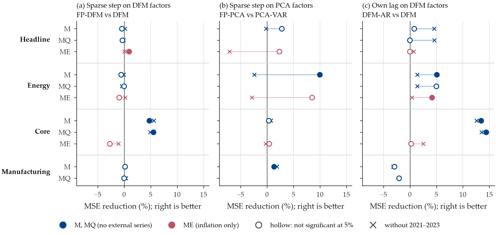

# Beyond Common Factors?

*The Predictive Value of Sparse Information in Euro-Area Forecasting*

Forecasts from large macroeconomic panels usually pass through a few common factors, and what the factors leave out, the idiosyncratic component of each series, is treated as noise.
FarmPredict ([Fan, Masini and Medeiros, 2023, *Annals of Statistics*](https://doi.org/10.1214/23-AOS2304)) instead adds a lasso forecast of the target's idiosyncratic component, built from the idiosyncratic components of all series.
We take FarmPredict to the euro area and ask two questions:

1. Does combining common factors with a sparse model of the idiosyncratic components improve forecasts over models that use either one alone?
2. Does information from outside the monthly euro-area panel (quarterly national accounts and labor-market series, external commodity, survey and uncertainty indices) improve the forecasts, and does its value depend on the model?

This repository holds the code, data and saved results behind every figure, table and number in the paper.

> **Abstract.** We examine whether sparse forecasts of idiosyncratic components improve factor-based predictions of euro-area headline, energy and core inflation and manufacturing production.
> Using EA-MD-QD and external indicators, we compare FarmPredict with factor-only, direct LASSO and autoregressive benchmarks in an expanding-window pseudo-real-time exercise respecting publication delays.
> Sparse corrections yield small, robust gains for core inflation with dynamic factors and manufacturing with principal components, but no systematic advantage over LASSO.
> Several rankings depend on the 2021–2023 crisis.
> Quarterly series improve manufacturing's factor forecasts; external indicators improve core factor forecasts and direct LASSO forecasts for all three inflation targets.
> Additional information helps mainly through factors or direct predictors, with limited gains from sparse residual corrections.

📄 Paper (PDF): added to [`paper/`](paper/) on submission &nbsp;·&nbsp; 🔁 [Rebuild the exhibits](replicate.sh) &nbsp;·&nbsp; 🧮 [Forecasting code](src/forecasting/)


<p align="center"></p>

## Design

| | |
|:--|:--|
| **Targets** | headline, energy and core HICP inflation; manufacturing industrial production; each forecast as its month-on-month change in percent |
| **Panel** | EA-MD-QD, release 09.2026 ([Barigozzi and Lissona](https://zenodo.org/records/23064892)): 47 monthly euro-area series, 16 quarterly series, and 24 external monthly series |
| **Information sets** | M (monthly panel), MQ (+ quarterly), ME (+ external); the saved run also has MQE (both), which the paper does not report |
| **Models** | RW, AR, PCR, PCA-VAR, FP-PCA (PCA + VAR + LASSO), DFM, DFM-AR, LASSO, FP-DFM (DFM + LASSO); 24 model-by-information-set specifications |
| **Factor step** | mixed-frequency dynamic factor model estimated by EM and the Kalman smoother, quarterly series through Mariano–Murasawa aggregation; principal components for the PCA variants |
| **Exercise** | pseudo-real-time on revised data: at the end of each month from January 2015 to August 2026 (140 dates) every model is re-estimated on the data published by then, each series with its own publication delay, and forecasts its target's first unpublished month |

## Reproduce

All commands run from the repository root.

**1. Environment.** Install [uv](https://docs.astral.sh/uv/), then

```sh
uv sync                              # Python 3.13, versions pinned in uv.lock
uv run ruff check . && uv run pytest # optional checks, under a minute
```

Without uv: `uv export --no-hashes --format requirements-txt > requirements.txt` on any machine with uv, then `pip install -r requirements.txt` in a Python 3.13 environment, and drop the `uv run` prefix below.

**2. Rebuild every exhibit from the saved forecasts** (about two minutes, no model is re-estimated):

```sh
./replicate.sh
```

The script moves the committed exhibits to `outputs/.previous/`, regenerates them, and ends with [`scripts/check_replication.py`](scripts/check_replication.py), which compares every rebuilt table and numbers file with the committed one; it should report all 38 as identical.
Figures and audit files are not compared: images depend on the platform's fonts and renderer, PDFs embed their creation date, and audit files record the paths and line endings of the machine that ran them.

**3. Re-estimate the forecasts (optional, hours).** The scripts refuse to overwrite saved results, so first move the saved runs out of `outputs/` (for example to `saved/`):

```sh
mkdir -p saved
mv outputs/forecasts/paper_experiment_nonzero_iqr outputs/forecasts/fixed_dfm_external_sparse_nonzero_iqr \
   outputs/reports/nonzero_robustness/mqe_ablation outputs/reports/industrial_nonzero saved/

uv run python -m scripts.paper_experiment               # main run: 4 targets x 24 specifications x 140 dates
uv run python -m src.forecasting.fixed_external         # fixed M factors, external series in the sparse step only (ME)
uv run python -m scripts.fixed_factor_mqe_nonzero       # the same with MQ factors (MQE)
uv run python -m scripts.industrial_nonzero_run         # ten-target M/MQ robustness, appendix
./replicate.sh
```

`scripts.paper_experiment --resume` continues an interrupted run; every run records the hashes of its configuration, data and source files and refuses to resume if any of them changed.
`outputs/forecasts/paper_experiment/` holds the forecasts of an earlier version of the main run, whose outlier rule was computed on all values rather than the nonzero ones; the paper uses it in one robustness check, and it is kept as saved forecasts only.

## Repository structure

```
.
├── replicate.sh            rebuild every exhibit from the saved forecasts and check them (step 2)
├── config/                 forecast_paper.yaml (main run), research_design.yaml, evaluation windows
├── data/                   EA-MD-QD 09.2026 as published, the 24 external series, metadata (data/README.md)
├── src/
│   ├── data/               loaders with publication delays; EA-MD-QD download
│   ├── preprocessing/      transformations
│   ├── forecasting/        mixed-frequency EM + Kalman DFM, PCA, VAR, LASSO, the forecast loop, scoring
│   ├── factors/            residual-dependence diagnostics
│   └── _style.py           every figure, table and quoted number goes through it
├── scripts/                one script per group of exhibits; paper_experiment.py runs the main design
├── tests/                  timing, leakage, PCA reconstruction, horizon indexing, reproducibility
└── outputs/
    ├── forecasts/          the saved runs: every forecast, score, selected predictor and fitted factor model
    ├── reports/            exhibits and numbers for Sections 4 and the appendix, each with its audit file
    ├── figures/, tables/   exhibits for Sections 2 and 3 and the appendix
    ├── numbers.tex         every number quoted in Sections 2 and 3, as LaTeX macros
    └── README.md           which script writes which exhibit
```

The paper reads `outputs/` directly: no number in it is typed by hand.
The LaTeX sources of the paper are not distributed.

## Notes for readers of the code

- Comments and saved manifests refer to choices by labels such as `D-68` or `D-72`. They point to the team's internal decision log, which is not distributed; every choice they mark is described in the paper's Data and Methodology sections.
- Model identifiers in the code and saved files differ from the paper's names: `FarmPredict` is FP-DFM, `PCA_VAR_LASSO` is FP-PCA, `DFM_AR` is DFM-AR, `PCA_VAR` is PCA-VAR.
- Audit files (`audit.json`, `metadata.json`) record the machine and local paths where each result was computed, as written at the time.
- The external series' `README.md` and `RIGHTS.md` are kept byte for byte as when the forecasts were computed, because the saved runs hash them as inputs.

## Context

Final paper for *Machine Learning for Economists* (Prof. Matteo Barigozzi), MSc in Economics and Econometrics, University of Bologna, A.Y. 2025/2026, by **Pietro Ganzerli, Pietro Menci and Gianluca Tisci**.
Coding agents (Claude Code, Codex) helped write the code, as the paper states.

## Data and licensing

- **EA-MD-QD** is redistributed under its CC BY-NC 4.0 licence. Cite: Barigozzi, M. and Lissona, C. (2024), "EA-MD-QD: Large Euro Area and Euro Member Countries Datasets for Macroeconomic Research", Zenodo; and Barigozzi, M., Lissona, C. and Tonni, L., *Journal of Applied Econometrics* (2026), doi:10.1002/jae.70083.
- **External series** come from the EIA and IMF via FRED, the World Bank, the ECB, the European Commission, the Federal Reserve Bank of New York, Caldara and Iacoviello, and Baker, Bloom and Davis; attribution and reuse terms for each file are in [`data/external/factor_sparse/RIGHTS.md`](data/external/factor_sparse/RIGHTS.md). They are redistributed for non-commercial academic use only.
- **Code** is released under the [MIT License](LICENSE).
